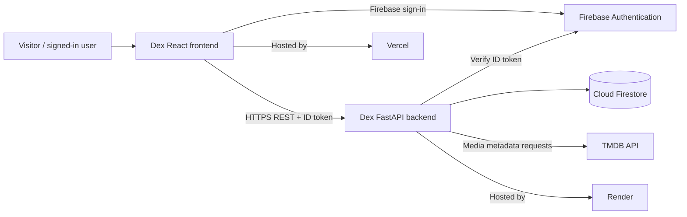
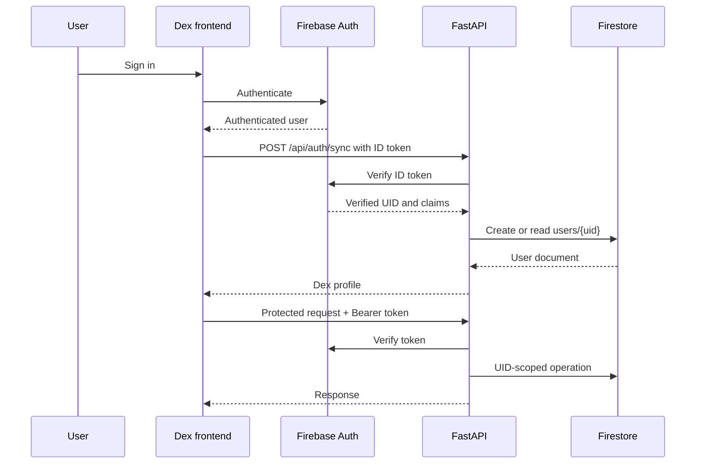
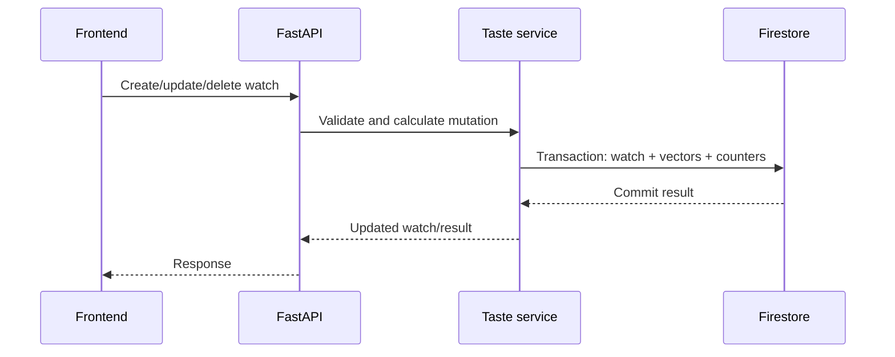

# System Architecture

> **Status:** Baseline — current logical architecture  
> **Owner:** Dex maintainers  
> **Last updated:** 2026-11-02  
> **Version:** 1.0

## 1. Architecture summary

Dex is a client/server web application. The React frontend handles navigation, presentation, Firebase client authentication, and authenticated API requests. The FastAPI backend owns API validation, Firebase token verification, TMDB integration, Firestore access, watch lifecycle operations, and taste-profile consistency.

Firebase Authentication is the identity provider. Firestore stores application data. TMDB is an external catalogue/metadata dependency. Vercel and Render host the frontend and backend respectively.

## 2. Architectural drivers

- User-specific data must be scoped to a server-verified Firebase UID.
- A user must not be able to claim a username owned by another account.
- Watch mutations and the associated taste-vector updates must remain consistent.
- External TMDB failures must not expose secrets or unhandled upstream details.
- Frontend secrets must not be relied upon for server-side privileged operations.

## 3. System context

## 4. Component architecture

| Component | Responsibility | Inputs | Outputs | Technology |
|---|---|---|---|---|
| Frontend pages | Discovery, details, profile, authentication and history UX | User actions, API responses, auth state | Rendered views and requests | React/TypeScript |
| Frontend auth helpers | Firebase setup and session state | Firebase SDK events | Current user and ID token | Firebase JS SDK |
| FastAPI application | Routes, middleware, validation, auth dependencies | HTTP requests | JSON responses/status codes | FastAPI |
| Firebase auth service | Verify Firebase ID tokens | Bearer token | Decoded identity | Firebase Admin |
| Firestore adapter | Access Firestore | Backend service calls | Documents/snapshots | Firebase Admin |
| TMDB service | Search/trending/details/related TMDB endpoints | Query/media identifiers | Normalized upstream data | HTTPX |
| TMDB catalog service | Cache metadata used by taste features | Media IDs and TMDB metadata | Feature metadata | Firestore + TMDB |
| Taste service | Compute, persist, reverse taste contributions | Watch data and metadata | Taste profile/vector updates | Python + Firestore transactions |
| Hosting | Serve app/API | Build artefacts/configuration | Public web/API | Vercel / Render |

## 5. Runtime and deployment view

- **Frontend:** Vite-built static assets deployed on Vercel.
- **Backend:** FastAPI ASGI application started by Uvicorn on Render.
- **Identity:** Firebase Authentication.
- **Persistent state:** Cloud Firestore.
- **External catalogue:** TMDB over HTTPS.
- **Configuration:** frontend `VITE_*` build variables; backend environment variables and secret files.
- **Startup:** FastAPI lifespan starts the TMDB HTTP client and closes it on shutdown.

## 6. Key sequence / data flows

### Sign-in and API access

### Watch mutation and taste update

If TMDB metadata is unavailable during a watch operation, the current service design permits the watch action to persist with taste metadata pending; later metadata-dependent operations can retry lookup. Confirm this invariant through tests before changing the service.

## 7. State ownership and consistency

| State | Authoritative owner | Lifetime | Consistency / recovery |
|---|---|---|---|
| Authentication identity | Firebase Auth | Session/account | Backend verifies ID token |
| Dex profile | `users/{uid}` | Persistent | UID-scoped Firestore document |
| Username ownership | `usernames/{username}` | Persistent | Registry document; collision guarded |
| Watch record | User watch subcollection | Persistent | API mutation path |
| Taste profile counters | User taste profile document | Persistent | Updated with watch transactions |
| Taste feature sums | User taste-vector feature docs | Persistent | Exact contribution reversal |
| TMDB metadata cache | `tmdb_catalog` | TTL/cache lifecycle | Re-fetch when stale/missing |

## 8. Failure modes and resilience

| Failure | Detection | System behaviour / recovery |
|---|---|---|
| Missing/invalid Firebase token | Auth dependency | HTTP 401 |
| User record not synchronized | Auth dependency lookup | HTTP 401 with sync requirement |
| Username collision | Registry conflict / AlreadyExists | HTTP 409 |
| Invalid request data | FastAPI/Pydantic validation | HTTP 422 |
| TMDB unavailable | TMDB service exception | Controlled upstream error response |
| Rate limit exceeded | SlowAPI | Rate-limit response and headers |
| Firestore unavailable | SDK exception | Operation fails; caller receives server error |
| Taste metadata unavailable | Catalog service failure handling | Preserve watch write; mark contribution pending where supported |

## 9. Observability

Current operational signals include managed-host logs, health endpoint, and automated CI. No formal metrics retention or production SLO is documented.

Recommended additions: request/error metrics, TMDB failure rate, Firestore mutation failures, rate-limit counts, taste-profile reconciliation, and latency histograms. Logs must not include ID tokens, service-account JSON, or private user notes.

## 10. Architecture constraints and trade-offs

- Firestore avoids operating a separate relational database but requires careful document/transaction design.
- TMDB reduces the need to maintain a media catalogue, at the cost of external availability, quota, attribution, and data-freshness dependencies.
- Firebase Authentication delegates credential handling while the backend remains responsible for token verification and authorization.
- Taste vectors are incrementally maintained to avoid recomputing the entire user history on each mutation.

## 11. Links

- [TRD](02_TRD.md)
- [Protocol and schema](06_Protocol_and_Data_Schema.md)
- [Security](08_Security.md)
- [Testing](09_Testing.md)
- [ADR index](../ADR/README.md)
