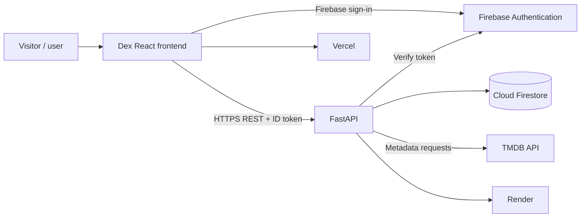
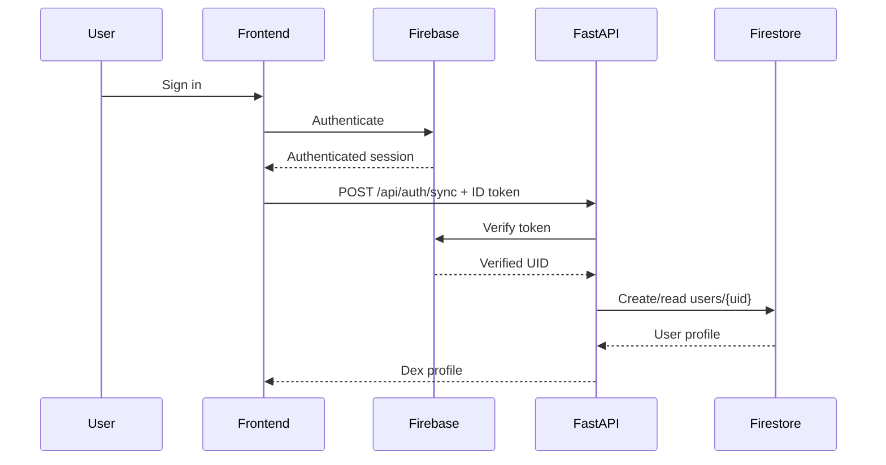
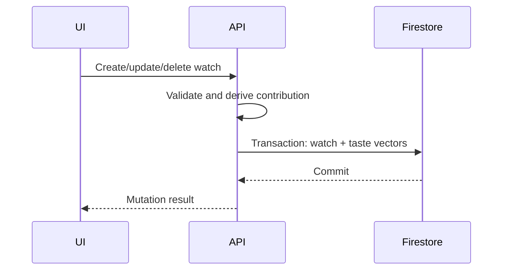
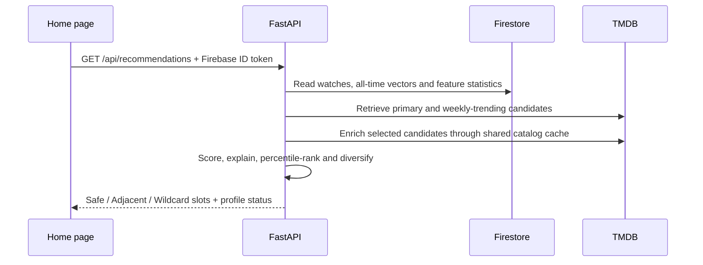

# System Architecture

> **Status:** Maintained architecture — current logical architecture  
> **Owner:** Dex maintainers  
> **Last updated:** 2026-11-02

## 1. Architecture summary

Dex is a client/server web application. The React frontend handles navigation, presentation, Firebase client authentication, and authenticated API requests. FastAPI owns request validation, Firebase token verification, TMDB integration, Firestore access, watch lifecycle operations, and taste consistency.

## 2. Architectural drivers

- User data must be scoped to a server-verified Firebase UID.
- Username ownership must be unique.
- Watch mutations and taste-vector updates must remain consistent.
- TMDB failures must be handled without exposing secrets.
- Privileged credentials must remain server-side.

## 3. System context

## 4. Component architecture

| Component | Responsibility | Technology |
|---|---|---|
| Frontend pages | Discovery, details, profile, auth/history UI | React/TypeScript |
| Frontend auth helpers | Firebase setup/session state | Firebase JS SDK |
| FastAPI app | Routes, middleware, validation/auth | FastAPI |
| Firebase auth service | Verify ID tokens | Firebase Admin |
| Firestore adapter | Read/write documents | Firebase Admin |
| TMDB service | Search/trending/details | HTTPX |
| TMDB catalog service | Cache taste feature metadata | Firestore + TMDB |
| Taste service | Compute/reverse vector contributions | Python + Firestore transactions |
| Recommendation service | Retrieve candidates, calculate signed relevance, diversify slots | Python + TMDB + Firestore feature statistics |
| Backfill service | Enrich legacy watched records with repeatable cursor pagination | Python + Firestore transactions |
| Hosting | Serve app and API | Vercel / Render |

## 5. Runtime and deployment

- Frontend: Vite-built assets on Vercel.
- Backend: FastAPI/Uvicorn on Render.
- Identity: Firebase Authentication.
- Persistent state: Cloud Firestore.
- Catalogue: TMDB over HTTPS.
- Configuration: VITE_ browser variables; backend environment/secrets.
- FastAPI lifespan starts/closes the TMDB HTTP client.

## 6. Key flows

### Authentication

### Watch and taste mutation

When TMDB metadata is unavailable, a watch can persist with taste metadata pending; the backfill endpoint can retry later.

### Personalized recommendations

### Historical taste backfill

The user invokes `POST /api/taste/backfill` in bounded pages. The service fetches missing TMDB features and uses the same transactional watch/taste mutation path used by normal watch updates. Cursor pagination resumes after the last processed watch; completed entries are skipped on a repeated pass.

## 7. State ownership

| State | Owner | Consistency |
|---|---|---|
| Authentication | Firebase Auth | Backend verifies ID token |
| Profile | users/{uid} | UID-scoped Firestore doc |
| Username ownership | usernames/{name} | Registry conflict handling |
| Watch | User watch subcollection | API mutation path |
| Taste counters | User taste profile | Updated with watch transaction |
| Recommendation feature frequencies | `tmdb_feature_stats` | Shared catalogue document-frequency index |
| Taste vectors | User taste_vectors hierarchy | Exact contribution reversal |
| Shared media features | tmdb_catalog | Cached/re-fetched metadata |

## 8. Failure modes

| Failure | Handling |
|---|---|
| Invalid/missing token | 401 |
| Unsynchronized Dex profile | Protected API rejects |
| Username collision | 409 |
| Invalid request | 422 |
| TMDB failure | Controlled upstream error |
| Rate limit exceeded | SlowAPI response |
| Firestore failure | Mutation fails |
| Taste metadata unavailable | Watch can persist as pending; backfill can retry |
| Missing production API routes | Deployment/version mismatch | Inspect `/api/health`, Render service branch/root, and active deploy; see runbook |

## 9. Observability

Current signals: managed-host logs, health endpoint, and CI. No formal production SLO/metrics retention is documented. Recommended metrics include request latency/error rate, TMDB failures, Firestore mutation failures, rate-limit counts, and taste reconciliation. Never log ID tokens, service-account JSON, or private notes.

## 10. Trade-offs

Firestore avoids operating a relational database but requires careful transaction design. TMDB avoids maintaining a catalogue but creates an external dependency. Firebase delegates credential lifecycle while backend authorization remains mandatory. Incremental taste vectors avoid full-history recalculation but require exact reversal and schema/model versioning.

## 11. Links

- [TRD](02_TRD.md)
- [Protocol/schema](06_Protocol_and_Data_Schema.md)
- [Security](08_Security.md)
- [Testing](09_Testing.md)
- [ADRs](../ADR/README.md)
- [Recommendation Engine](11_Recommendations_Engine.md)
- [Deployment Runbook](12_Deployment_Runbook.md)
