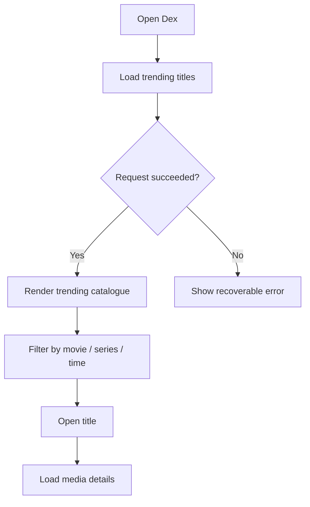
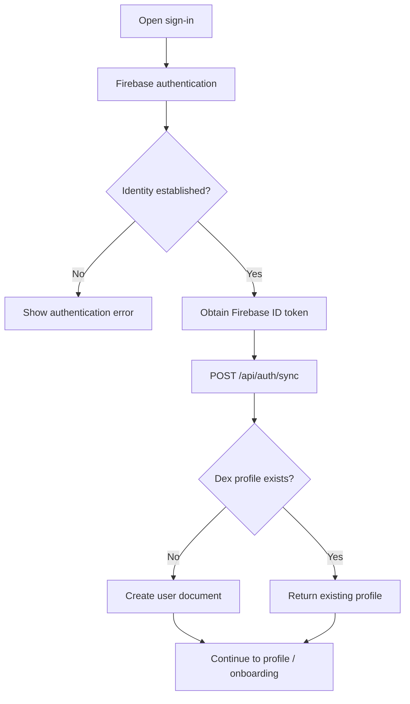
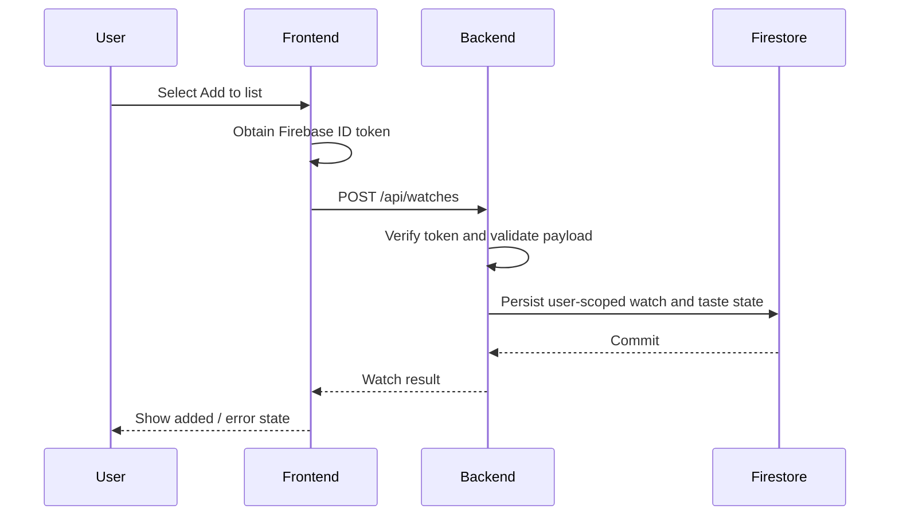

# Application and Operational Flow

> **Status:** Baseline — current principal user journeys  
> **Owner:** Dex maintainers  
> **Last updated:** 2026-11-02

## 1. Entry points and actors

| Actor | Entry point | Goal | Prerequisites |
|---|---|---|---|
| Visitor | Home/discovery | Browse trending titles | Browser and network |
| Visitor | Search | Find a movie or series | Search query |
| Visitor | Media details | Inspect title metadata and availability | Valid media identifier |
| User | Sign-up/sign-in | Establish account identity | Firebase-supported sign-in |
| User | Profile | Review personal identity/history | Authenticated session |
| User | Watch management | Record or edit viewing activity | Authenticated API session |

## 2. Primary journeys

### Discovery

### Account and profile

### Add a title to the user's list

## 3. Watch state model

| Status | Meaning | Taste contribution |
|---|---|---|
| `watched` | User has watched the title | Included |
| `want_to_watch` | User intends to watch | Excluded |
| `in_future` | User plans to watch later | Excluded |

Changing a record's status can change whether it contributes to taste. The service must reverse an old contribution before applying a new one.

## 4. Alternate and failure flows

| Scenario | Expected behaviour |
|---|---|
| TMDB search/trending fails | Show an error or empty recoverable state; allow retry |
| Invalid media route or identifier | Return validation/not-found state |
| User is not authenticated | Prompt sign-in before protected actions |
| ID token missing/invalid | API rejects with HTTP 401 |
| Username already taken | API returns HTTP 409; user chooses another |
| Duplicate watch record | Backend conflict response; UI should not create a duplicate |
| Firestore unavailable | Mutation fails; do not show false success |
| TMDB taste metadata unavailable | Watch may be saved with taste update pending per service behaviour |
| User navigates away during request | UI should avoid stale state updates where request cancellation is implemented |

## 5. Lifecycle and ownership

- Firebase client SDK owns client authentication state.
- The backend owns authorization decisions and Firestore operations.
- User data is scoped by verified Firebase UID, not by a UID supplied in request bodies.
- The backend's FastAPI lifespan starts and closes the TMDB HTTP client.
- Watch create/update/delete operations must keep persisted watch records and taste contributions consistent.

## 6. Flow-to-requirement mapping

| Flow / state | PRD requirement IDs | Verification |
|---|---|---|
| Trending/search | FR-001, FR-002 | TMDB/API tests |
| Media details | FR-003 | Media endpoint tests |
| Sign-in/sync | FR-004, FR-005 | Firebase/API tests |
| Username claim | FR-006 | Collision tests |
| Watch CRUD | FR-007, FR-008 | API tests |
| Taste update/reversal | FR-009, FR-010 | Taste service regression tests |
