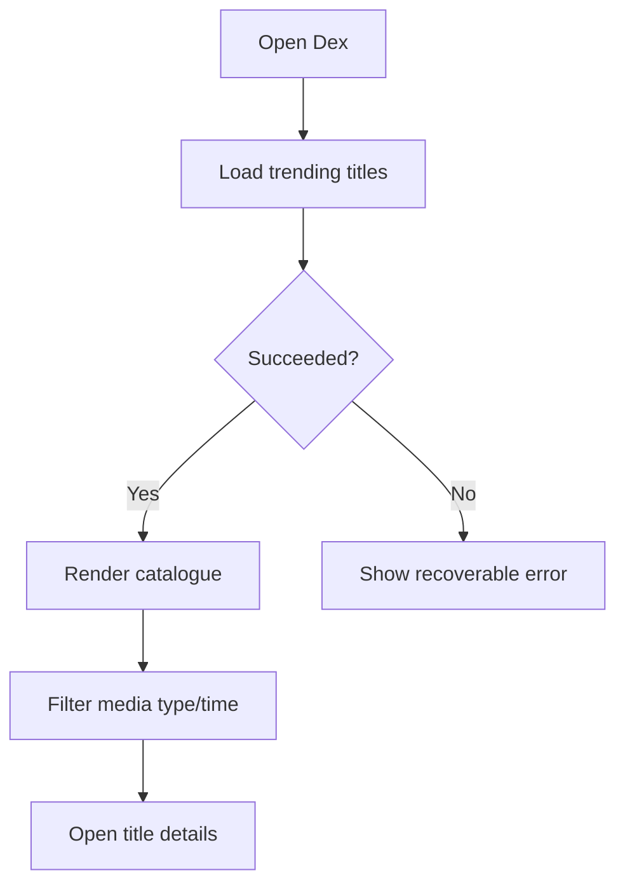
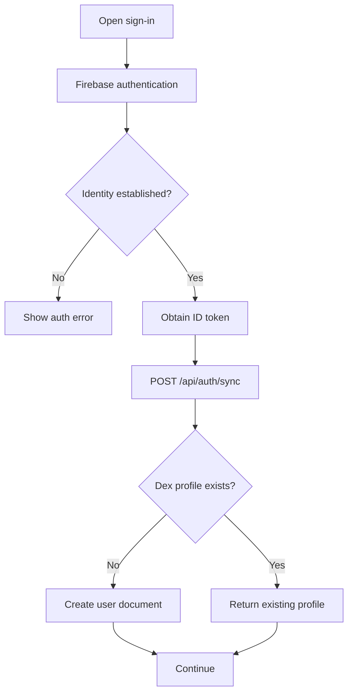
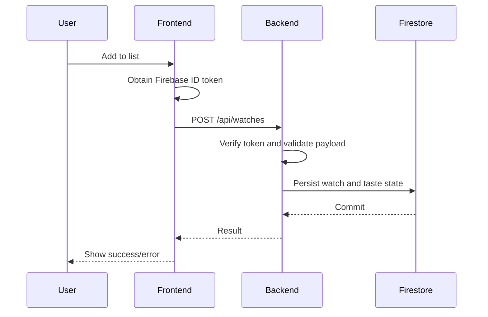

# Application and Operational Flow

> **Status:** Baseline — current principal journeys  
> **Owner:** Dex maintainers  
> **Last updated:** 2026-11-02

## 1. Entry points and actors

| Actor | Entry point | Goal | Prerequisite |
|---|---|---|---|
| Visitor | Home | Browse trending titles | Browser/network |
| Visitor | Search | Find title | Search query |
| Visitor | Media details | Inspect media | Valid media ID |
| User | Sign-in | Establish account | Firebase-supported sign-in |
| User | Profile | Review identity/history | Authenticated session |
| User | Watch management | Record viewing activity | Authenticated API access |

## 2. Primary journeys

### Discovery

### Account and profile

### Watch mutation

## 3. Watch state model

| Status | Meaning | Taste contribution |
|---|---|---|
| watched | User has watched title | Included |
| want_to_watch | User intends to watch | Excluded |
| in_future | User plans to watch later | Excluded |

A status transition can change whether an item contributes to taste. Reverse an old contribution before applying a new one.

## 4. Alternate and failure flows

| Scenario | Expected behaviour |
|---|---|
| TMDB failure | Recoverable error/retry |
| Invalid media identifier | Validation/not-found state |
| User not signed in | Prompt authentication |
| Invalid ID token | API returns 401 |
| Username taken | API returns 409 |
| Duplicate watch | Conflict/idempotent response as implemented |
| Firestore unavailable | Do not show false success |
| TMDB taste metadata unavailable | Watch may persist with taste update pending |
| Request cancellation/navigation | Avoid stale UI updates where implemented |

## 5. Lifecycle and ownership

Firebase SDK owns client session state. Backend owns authorization and Firestore operations. UID is derived from verified credentials. FastAPI lifespan starts/closes TMDB client. Watch mutations must keep source record and taste contributions consistent.

## 6. Traceability

| Flow | PRD requirements | Verification |
|---|---|---|
| Trending/search | FR-001, FR-002 | API tests |
| Media details | FR-003 | Media tests |
| Sign-in/sync | FR-004, FR-005 | Auth tests |
| Username | FR-006 | Collision tests |
| Watch CRUD | FR-007, FR-008 | API tests |
| Taste mutation | FR-009, FR-010 | Taste regression tests |
