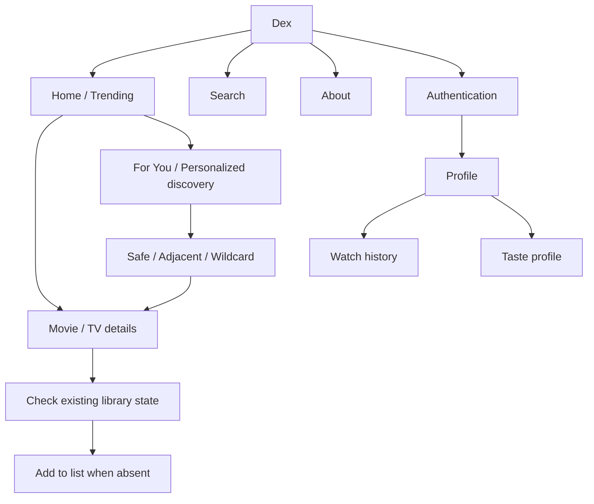

# UI / UX Design Brief

> **Status:** Maintained UX brief — derived from current frontend  
> **Owner:** Dex maintainers  
> **Last updated:** 2026-11-02

## 1. UX objectives

- Make discovery fast and visually clear.
- Keep watch activity and profile identity understandable.
- Minimise friction between discovery and logging.
- Present taste as an interpretation of recorded viewing activity, not an objective personality assessment.
- Maintain responsive behaviour across mobile and desktop.

## 2. Users and usage context

Entertainment viewers use Dex through modern browsers, on mobile for casual browsing and desktop for longer discovery/history sessions. Network access is required for remote catalogue and account data.

## 3. Information architecture

Check the router/navigation source for exact route paths before changing contracts.

## 4. Screen inventory

| Screen | Purpose | Actions | Key states |
|---|---|---|---|
| Home | Trending and personalized discovery | Search, filter, refresh recommendations, open title, build taste profile | Loading/populated/empty/error/backfill pending |
| Search | Find media | Search/filter/open | Empty/loading/results/error |
| Media details | Inspect title and current list state | Back/add when absent | Loading/error/details/checking/already watched/in watchlist/planned/add pending/error |
| Authentication | Establish identity | Sign-in/sign-up | Pending/success/error |
| Profile | User identity | View history/actions | Loading/signed-in/out |
| Watch list/history | Manage records | Add/edit/delete/status/rating | Empty/populated/mutation |
| About | Explain Dex | Start/create account | Static |
| Privacy/terms | Policy content | Read | Static |

## 5. Key screen specifications

### Home, For You and search
Present the search entry point and trending catalogue. For authenticated users, render a Personalized Discovery section with Safe, Adjacent, and Wildcard cards plus refresh. If no watched titles exist, prompt the user to mark titles watched and rate them. If watched items have pending metadata, expose the profile-build/backfill action and progress/error state. Explain that match values are candidate-pool percentiles, not probabilities. Use loading, populated, empty, and recoverable error states.

### Media details
Present poster/backdrop, title, type, release/air date, runtime, rating, genres, overview, and India provider data when returned. Once authenticated, check `GET /api/watches/{watch_id}` before enabling Add to list. Render an existing-state label (Already watched, In your watchlist, Planned for later) rather than encouraging a duplicate. Show pending and API error feedback; do not show success before the API confirms it.

### Profile and watch records
Present the user's Dex identity and records. All private records must remain server-authorized and UID-scoped.

## 6. Design system

Current UI uses a dark visual theme, violet/purple accents, muted slate text, translucent surfaces, rounded cards, and a persistent animated background. Tailwind CSS 4 provides styling utilities; Lucide React supplies icons. Exact source tokens live with frontend styles.

## 7. Interaction and feedback

- Show loading states for async requests.
- Distinguish empty results from errors.
- Prevent repeated mutation submissions while pending where implemented.
- Clearly label watch statuses.
- Do not show success until the API confirms it.
- Treat `404` from the user-scoped watch lookup as “not in this user's library”; treat `405` as an API deployment/route mismatch, not as “not found.”
- Streaming-provider data is availability information, not playback delivered by Dex.

## 8. Responsive/platform behaviour

Frontend uses responsive utility classes and adaptive layouts. Validate home, search, details, authentication, and profile at narrow mobile and desktop widths. Exact browser support targets remain to be formalised.

## 9. Assets and references

- Assets: frontend/public/
- UI source: frontend/src/
- Live site: https://dex-list.vercel.app/
- Research: [Research documentation](../Research%20documentation/)
