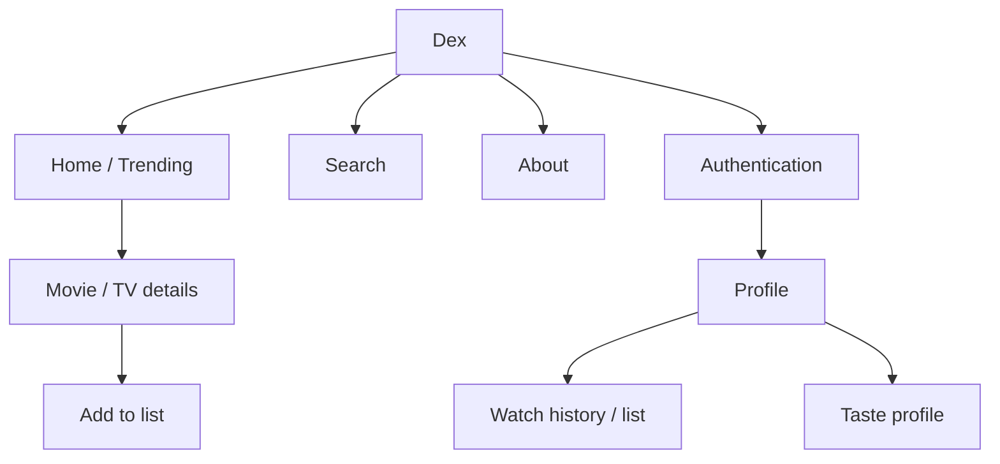

# UI / UX Design Brief

> **Status:** Baseline — derived from current frontend  
> **Owner:** Dex maintainers  
> **Last updated:** 2026-11-02

## 1. UX objectives

- Make media discovery fast and visually clear.
- Keep watch activity and profile identity understandable.
- Require minimal friction between discovering a title and recording it.
- Present taste as an interpretation of a user's own recorded viewing activity, not as an objective personality assessment.
- Maintain coherent responsive behaviour across mobile and desktop browsers.

## 2. Users and usage context

Dex is used by entertainment viewers through modern browsers. Common contexts include casual browsing on mobile and longer discovery/history sessions on desktop. Network connectivity is required for remote catalogue and account data.

## 3. Information architecture

Route inventory is maintained by the frontend router/navigation implementation; verify exact paths there before changing route contracts.

## 4. Screen inventory

| Screen / surface | Purpose | Primary actions | Key states |
|---|---|---|---|
| Home | Trending discovery | Select media type/time range; open title | Loading, populated, error |
| Search | Query catalogue | Search/filter/open result | Empty, loading, populated, error |
| Media details | Inspect one title | Back; add to list | Loading, error, details, added |
| Sign-up/auth | Establish Firebase identity | Sign in/sign up | Pending, success, validation/error |
| Profile | Present user's Dex identity | Navigate history and profile actions | Loading, signed-in, signed-out |
| Watch history/list | Manage viewing records | Add/edit/delete/status/rating | Empty, populated, mutation/error |
| About | Explain product concept | Start exploring/create account | Static content |
| Privacy/terms | Legal and policy information | Read policy | Static content |

## 5. Screen specifications

### Home / discovery

- **Purpose:** Surface trending media.
- **Content hierarchy:** Brand/navigation, discovery controls, media results.
- **Primary action:** Open a media item.
- **States:** Loading placeholders, populated results, recoverable failure.
- **Data:** Backend trending endpoint, which proxies TMDB.

### Search

- **Purpose:** Search movie and television titles.
- **Primary action:** Submit query and inspect results.
- **Constraints:** API query length is bounded; page and media type are validated server-side.

### Media details

- **Purpose:** Present title metadata and provider availability.
- **Primary action:** Add title to the authenticated user's list.
- **Content:** Poster/backdrop, title, media type, date, runtime, rating, genres, overview, providers for India when returned.
- **States:** Loading, title unavailable/error, loaded, already added, mutation error.

### Profile and watch records

- **Purpose:** Represent the user's entertainment identity and recorded activity.
- **Primary action:** Inspect and manage viewing records.
- **Privacy:** User-owned records must only be exposed through authorized server-side checks.

## 6. Design system

Current frontend uses a dark visual theme with purple/violet accents, muted slate text, translucent surfaces, rounded cards, and a persistent animated background. Tailwind CSS 4 provides styling utilities. Lucide React supplies icons.

Exact design tokens are defined by frontend styles; this document records the observed direction rather than creating a competing token source.

## 7. Interaction and feedback

- Use visible loading states for asynchronous catalogue/detail requests.
- Show recoverable errors without implying a failed action succeeded.
- Disable repeated submission while a mutation is pending where implemented.
- Clearly distinguish watch statuses.
- Do not display authenticated profile or watch actions as successful until the API confirms them.
- External streaming links/providers must be labelled as availability information, not playback provided by Dex.

## 8. Responsive and platform behaviour

The current UI uses responsive utility classes and adaptive grid/flex layouts. Validate home, search, media details, authentication, and profile at narrow mobile widths and desktop widths. Exact browser/OS support targets remain to be formalised.

## 9. Design assets and references

- Source assets: `frontend/public/`
- Frontend implementation: `frontend/src/`
- Live product: https://dex-list.vercel.app/
- Product/design research: [Research documentation](../Research%20documentation/)
