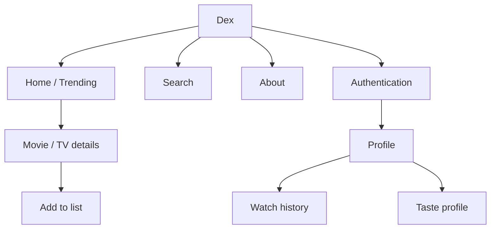

# UI / UX Design Brief

> **Status:** Baseline — derived from current frontend  
> **Owner:** Dex maintainers  
> **Last updated:** 2026-11-02

## 1. UX objectives

- Make discovery fast and visually clear.
- Keep watch activity and profile identity understandable.
- Minimise friction between discovery and logging.
- Present taste as an interpretation of recorded viewing activity, not an objective personality assessment.
- Maintain responsive behaviour across mobile and desktop.

## 2. Users and usage context

Entertainment viewers use Dex through modern browsers, on mobile for casual browsing and desktop for longer discovery/history sessions. Network access is required for remote catalogue and account data.

## 3. Information architecture

Check the router/navigation source for exact route paths before changing contracts.

## 4. Screen inventory

| Screen | Purpose | Actions | Key states |
|---|---|---|---|
| Home | Trending discovery | Filter/open title | Loading/populated/error |
| Search | Find media | Search/filter/open | Empty/loading/results/error |
| Media details | Inspect title | Back/add to list | Loading/error/details/added |
| Authentication | Establish identity | Sign-in/sign-up | Pending/success/error |
| Profile | User identity | View history/actions | Loading/signed-in/out |
| Watch list/history | Manage records | Add/edit/delete/status/rating | Empty/populated/mutation |
| About | Explain Dex | Start/create account | Static |
| Privacy/terms | Policy content | Read | Static |

## 5. Key screen specifications

### Home and search
Present discovery controls and catalogue cards. Use loading, populated, empty, and recoverable error states. Search inputs are bounded by the API.

### Media details
Present poster/backdrop, title, type, release/air date, runtime, rating, genres, overview, and India provider data when returned. Adding to a list requires authentication; show pending, added, and error feedback.

### Profile and watch records
Present the user's Dex identity and records. All private records must remain server-authorized and UID-scoped.

## 6. Design system

Current UI uses a dark visual theme, violet/purple accents, muted slate text, translucent surfaces, rounded cards, and a persistent animated background. Tailwind CSS 4 provides styling utilities; Lucide React supplies icons. Exact source tokens live with frontend styles.

## 7. Interaction and feedback

- Show loading states for async requests.
- Distinguish empty results from errors.
- Prevent repeated mutation submissions while pending where implemented.
- Clearly label watch statuses.
- Do not show success until the API confirms it.
- Streaming-provider data is availability information, not playback delivered by Dex.

## 8. Responsive/platform behaviour

Frontend uses responsive utility classes and adaptive layouts. Validate home, search, details, authentication, and profile at narrow mobile and desktop widths. Exact browser support targets remain to be formalised.

## 9. Assets and references

- Assets: frontend/public/
- UI source: frontend/src/
- Live site: https://dex-list.vercel.app/
- Research: [Research documentation](../Research%20documentation/)
