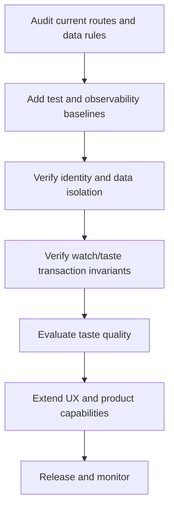

# Implementation Plan

> **Status:** Existing product baseline with ongoing improvement backlog  
> **Owner:** Dex maintainers  
> **Last updated:** 2026-11-02

## 1. Delivery strategy

Dex already has a deployed end-to-end implementation. Further delivery should protect current user data and taste-engine consistency, close security/operational gaps, and only then expand recommendation capabilities.

## 2. Work breakdown

| Phase | Objective | Deliverables | Dependencies | Exit criteria |
|---|---|---|---|---|
| 0. Existing baseline | Preserve working product | React frontend, FastAPI API, Firebase/Firestore, TMDB integration | Current deployments | CI passes and production health is verified |
| 1. Integrity hardening | Protect account/watch/taste data | Authz review, transaction tests, reconciliation tooling | Firestore test strategy | UID isolation and mutation invariants verified |
| 2. Product completeness | Improve discovery and profile workflows | UX edge-case fixes, loading/empty/error states | Product decisions | Acceptance criteria met |
| 3. Taste model validation | Validate signal quality | Dataset fixtures, model evaluation, versioned scoring | Representative anonymised fixtures | Quality measured and limitations documented |
| 4. Operational hardening | Improve production operation | Shared rate-limit store, logs/metrics, backup and recovery plan | Hosting and infra config | Runbooks and operational checks approved |
| 5. Release | Ship verified changes | Release notes and deployment verification | CI and review | No unresolved release-blocking defects |

## 3. Dependency order

## 4. Milestones

| Milestone | Target date | Completion evidence | Status |
|---|---|---|---|
| Production web/API baseline | Existing deployment | Vercel/Render URLs | Deployed |
| Taste engine V1 | Existing implementation | Backend service and regression tests | Implemented; continue validation |
| Documentation baseline | 2026-11-02 | Core docs and ADR set | In progress in docs branch |
| Security and data lifecycle audit | TBD | Review report and tests | Not started |
| Taste model evaluation | TBD | Reproducible evaluation report | Not started |

## 5. Work tracking

- Repository: https://github.com/Shreyas-patil07/Dex
- CI: https://github.com/Shreyas-patil07/Dex/actions
- Deployment: Vercel and Render dashboards.

Use GitHub issues for task-level ownership and status; do not duplicate issue lists here.

## 6. Definition of done

- Acceptance criteria are met.
- Relevant automated tests pass.
- Auth and data-isolation impacts are reviewed.
- Watch/taste transaction consistency is preserved.
- API and data docs are updated.
- Secrets and production configuration are not exposed.
- CI and deployment checks pass.

## 7. Risks and contingencies

| Risk | Trigger | Impact | Mitigation |
|---|---|---|---|
| Taste changes corrupt aggregate vectors | Scoring or transaction refactor | Incorrect profile | Reversal/reconciliation tests and backups |
| TMDB data shape changes | Upstream API changes | Search/detail/taste breakage | Contract tests and defensive validation |
| Firestore scaling/cost | Increased watch history or reads | Cost and latency | Profile queries and usage |
| Multi-instance API | More than one Render worker/instance | Local rate counters diverge | Shared Redis store |
| Unreviewed Firestore rules | Production rules differ from assumptions | Data exposure | Security audit |
