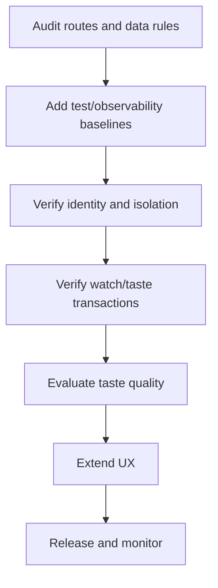

# Implementation Plan

> **Status:** Existing product baseline with ongoing improvement backlog  
> **Owner:** Dex maintainers  
> **Last updated:** 2026-11-02

## 1. Delivery strategy

Dex already has a deployed end-to-end implementation. Future delivery should protect user data and taste consistency, close security/operational gaps, then expand recommendation capabilities.

## 2. Work breakdown

| Phase | Objective | Deliverables | Exit criteria |
|---|---|---|---|
| 0. Baseline | Preserve working product | React frontend, FastAPI API, Firebase/Firestore, TMDB | CI and health verified |
| 1. Integrity | Protect user/watch/taste data | Authz review, transaction tests, reconciliation | UID isolation and mutation invariants pass |
| 2. Product | Improve discovery/profile flows | UX edge-case fixes | Acceptance criteria met |
| 3. Taste validation | Assess signal quality | Fixtures, model evaluation, versioned scoring | Quality and limits documented |
| 4. Operations | Improve service operation | Shared rate limits, metrics, backup/recovery plan | Runbooks reviewed |
| 5. Release | Ship verified changes | Release notes and smoke checks | No release blockers |

## 3. Dependency order

## 4. Milestones

| Milestone | Target | Evidence | Status |
|---|---|---|---|
| Production web/API baseline | Existing | Vercel/Render URLs | Deployed |
| Taste engine V1 | Existing | Service and regression tests | Implemented; continue evaluation |
| Documentation baseline | 2026-11-02 | Core docs and ADR set | In progress |
| Security/data lifecycle audit | TBD | Review and tests | Not started |
| Taste model evaluation | TBD | Reproducible report | Not started |

## 5. Work tracking

- Repository: https://github.com/Shreyas-patil07/Dex
- CI: https://github.com/Shreyas-patil07/Dex/actions
- Deployments: Vercel and Render dashboards.

Use GitHub issues for task status.

## 6. Definition of done

Acceptance criteria met; automated tests pass; auth/data-isolation reviewed; watch/taste integrity preserved; docs updated; secrets safe; CI/deployment checks pass.

## 7. Risks

| Risk | Impact | Mitigation |
|---|---|---|
| Taste aggregate drift | Incorrect profile | Reversal/reconciliation tests and backups |
| TMDB schema changes | Discovery/detail failures | Contract tests and validation |
| Firestore growth/cost | Cost/latency | Profile query and usage |
| Multi-instance backend | Divergent local rate limits | Shared Redis |
| Unreviewed Firestore rules | Data exposure | Production security audit |
